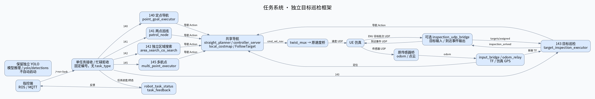
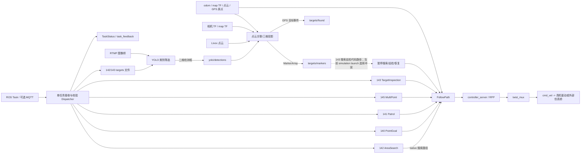

# 整体框架与数据链路

板卡源码结构及模式限制见 [开发交接总览](DEVELOPER_HANDOVER.md)。下图画的是板卡源码中的实际模块边界；
143 搜索巡检在 `simulation.launch.py` 中存在开关优先级冲突，图中虚线标出需修复后验证的链路。

[高清 SVG](diagrams/target_framework.svg) · [全部模块内部流程图](diagrams/MODULES.md)

## 生命周期和职责

- `task_pipeline` 空闲时校验并接收固定编号任务，忙碌时直接拒收；它派发 Action、跟踪终态并发布状态，不实现导航算法。
- 140/141/145 使用现有 PointGoal、Patrol 和多点串行执行器。
- 142 的 Python 执行器管理区域任务、传感器和导航 readiness；独立 native 引擎构建地图、产生路径；Nav2
  的 FollowPath 负责控制和碰撞检查。
- 143 默认 `target_inspection` 消费 `targets/assigned`；`search_inspection` 是另一条区域搜索观察路径，使用
  MarkerArray 暂停搜索、观察后恢复。板卡仿真入口当前存在 launch 标志优先级冲突，见交接总览。
- `yolo_detector` 负责二维检测和点云投影；`simulation_target_marker` 负责仿真目标事件及观察标记。
  两者不是同一个节点。
- `robot_launch` 管理公共导航 TF 与静态雷达/相机外参；仿真/UE 仍在外部工作空间提供传感器与消费速度。

## 坐标与话题约定

点云与相机检测按消息时间戳做 TF，不应用“当前机器人位姿”替代采集时刻。YOLO 三维位置在机器人 map 坐标系，
Marker 的 `pose.position` 单位为米；CameraInfo/YAML 内参负责像素投影，外参来自 TF。
Nav2 点云障碍高度过滤和 co-search 高度过滤是各自独立的配置。

主要状态话题：`/<ns>/robot_task_status`、`/<ns>/task_feedback`、`/<ns>/area_search/status`、
`/<ns>/co_search/engine_state`。主要感知输出：`/<ns>/yolo/detections`、`/<ns>/targets/markers`、
`/<ns>/targets/found`。相对名称会自动落在 ROS namespace 下。

## 工作空间边界

`outdoor_nav` 与 `sim_ws` 分开构建。`launch_sim.sh` 是连接已运行仿真的导航入口，不负责启动 UE/Gazebo；
真机入口 `launch_real.sh` 启用硬件驱动。两个工作空间须使用一致的 ROS domain、namespace、GPS/ENU 原点和
时间基准。
