# 当前任务框架 · 模块内部流程图

[整体说明](../DATA_FLOW.md) · [总体 SVG](target_framework.svg)

## 指令入口、调度与取消

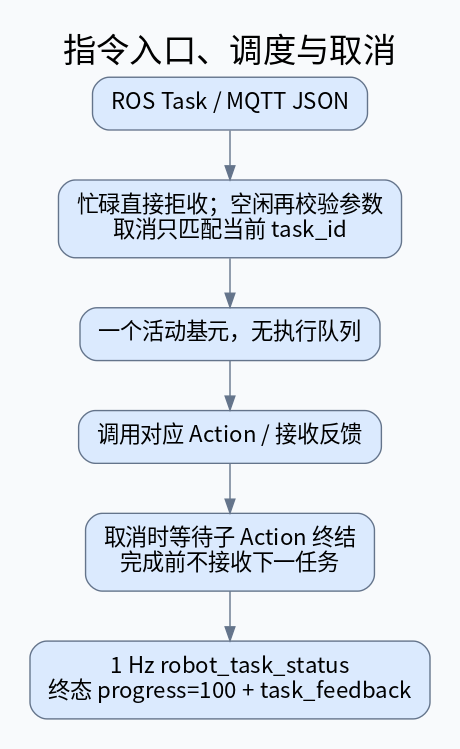

[高清 SVG](modules/01_task_pipeline.svg) · [DOT](modules/01_task_pipeline.dot)

## 140 定点导航

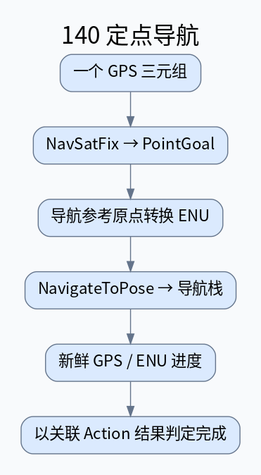

[高清 SVG](modules/02_point_goal.svg) · [DOT](modules/02_point_goal.dot)

## 141 两点巡线

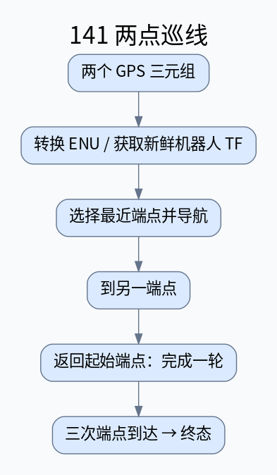

[高清 SVG](modules/03_patrol_line.svg) · [DOT](modules/03_patrol_line.dot)

## 145 多航点巡线

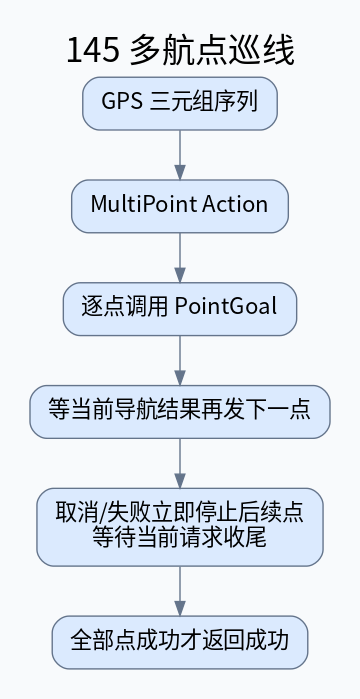

[高清 SVG](modules/04_multi_point.svg) · [DOT](modules/04_multi_point.dot)

## 142 独立区域搜索

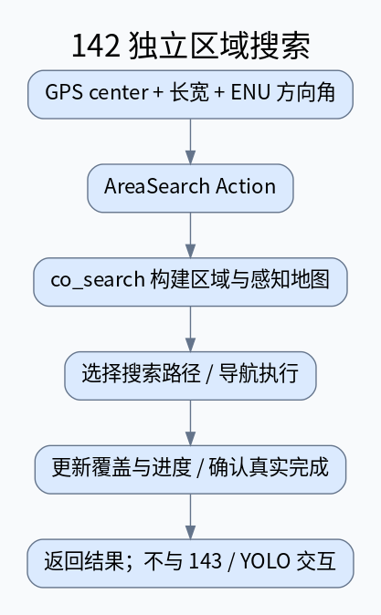

[高清 SVG](modules/05_area_search.svg) · [DOT](modules/05_area_search.dot)

## 143 目标巡检

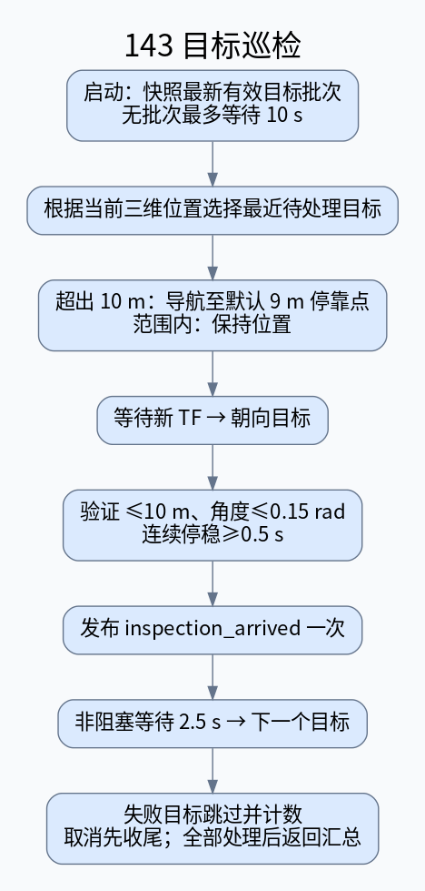

[高清 SVG](modules/06_target_inspection.svg) · [DOT](modules/06_target_inspection.dot)

## 目标批次管理

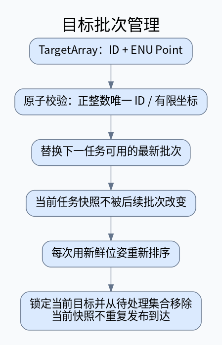

[高清 SVG](modules/07_target_manager.svg) · [DOT](modules/07_target_manager.dot)

## 接近、朝向与停稳检查

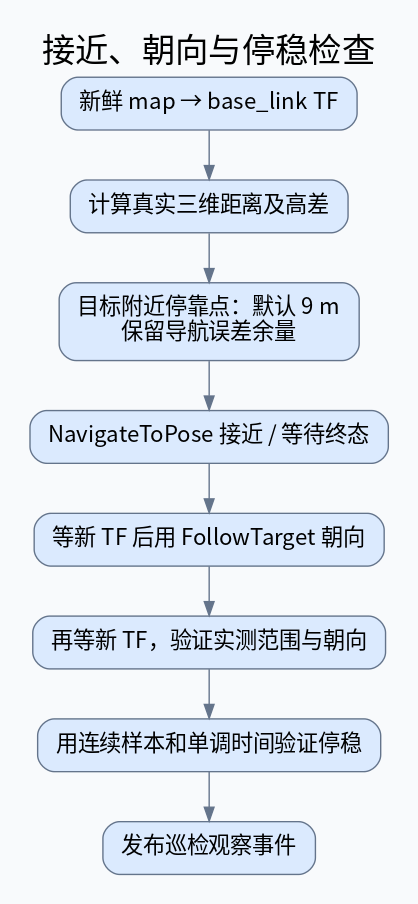

[高清 SVG](modules/08_approach_heading.svg) · [DOT](modules/08_approach_heading.dot)

## 共享运动控制

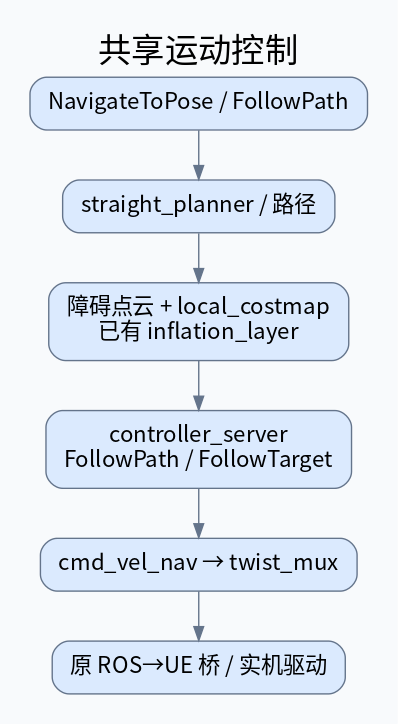

[高清 SVG](modules/09_motion_control.svg) · [DOT](modules/09_motion_control.dot)

## 巡检 UDP 传输（可选）

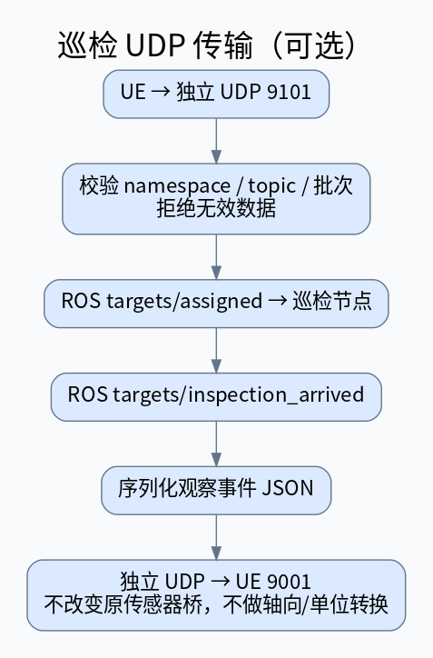

[高清 SVG](modules/10_udp_bridge.svg) · [DOT](modules/10_udp_bridge.dot)

## 定位与环境信息

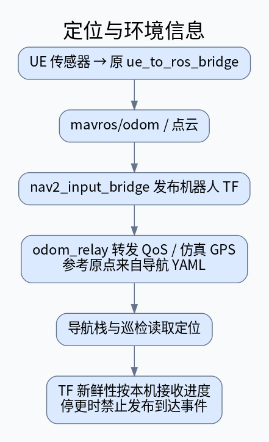

[高清 SVG](modules/11_localization.svg) · [DOT](modules/11_localization.dot)

## 任务与巡检反馈

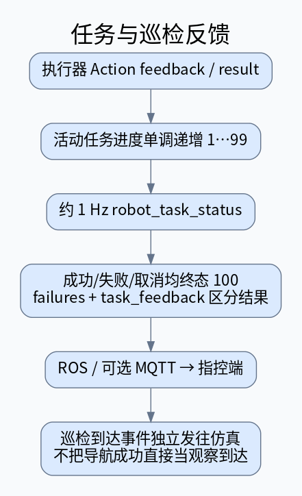

[高清 SVG](modules/12_feedback.svg) · [DOT](modules/12_feedback.dot)
