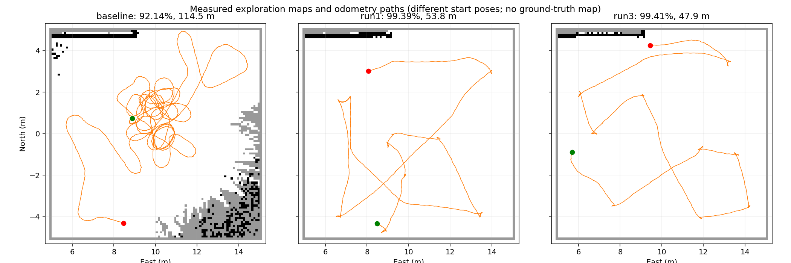

# 单机区域搜索实测记录（2026-11-02）

目标：在原有 agriculture 仿真中运行 robot_1 的 10 m × 10 m 区域搜索，减少重复往返，修正地面/悬空结构高度判断，并恢复可靠的路径对齐转向。

**严格矩形覆盖率尚未达到 100%。最高为 99.41%，剩余 0.59 m² 保留未知。** 没有缩小区域、降低完成门槛、直接填充未知格、导入 Gazebo 真值地图或伪造定位。

后续按用户要求增加了封闭障碍内未知格填充，并将推断面积计入覆盖率、与直接观测单独统计。以下记录来自增加填充之前，保留原始严格观测率，不据新口径追溯改写。

## 运行结果

| 轮次 | 严格观测率 | 里程计路程 | 时长 | 0.25 m 栅格重复进入比例 | 终态 |
|---|---:|---:|---:|---:|---|
| 基线 | 92.14% | 114.55 m | 339.2 s | 47.2% | 手动取消，开始部署修正 |
| 第一轮 | 99.39% | 53.76 m | 159.9 s | 20.2% | partial |
| 第二次有效运行 | 99.41% | 47.88 m | 160.7 s | 22.0% | partial |

不同轮次的起点和起始朝向不同，且同时修改了观测融合与规划评分，因此这不是控制变量 A/B 实验。路程来自导航里程计，包含其噪声与漂移；重复比例按连续轨迹进入的 0.25 m 格子计算。原始数值和起终点见 [metrics.json](metrics.json)。run2 因启动 RPC 响应丢失未进入导航，不作为有效运动对比；该问题已修复为超时重试。

地图白色为空闲，黑色为障碍，灰色为当前未知；橙色为里程计轨迹，绿点为起点，红点为终点。覆盖率累计本次任务曾被有效观测确认的唯一格子，当前占据置信度下降不抹去历史观测事实。

## 最后的未知区域

第一轮最后 61 格、第二次有效运行最后 59 格集中在北侧边缘。实际雷达回波在这一带从地面延伸到约 5 m 高；车体高度带内回波集中在约 north=4.65～4.69 m 的墙面。

在最终观测地图中离线遍历约 9,468 个可通行格子，对剩余 59 个未知格检查 5 m 范围内的二维视线，全部被已观测墙体阻挡。这个检查基于观测地图，不是场景真值，也不将视线预测算作观测。明细见 [occlusion_cells.json](occlusion_cells.json)。墙后/墙体内部的格子没有被报告成已探索。严格的整个矩形 100% 与“可观测区域完成”需要区分，后者目前没有替代任务成功条件。

## 实现修正

- 参考本地 co-search 的 `ViewNode::computeCost`、`PickBestUtilityViewpoint`：前沿收益结合距离、初始转向代价评分；Dijkstra 给重复经过的格子增加软代价。保留目标切换滞回及执行中的地图重评估。
- 无常规可用前沿时，搜索残余未知区域的观察位置；所有机器人目标仍需已知空闲、可达并满足边界和障碍约束。预测可见性不会增加覆盖率。
- 两张地图统一使用实测地面参考系和 0.05～0.35 m 障碍高度带。局部点云地面拟合受 IMU 法向、拟合残差、支撑点数和偏置范围约束，并做低通滤波。地面实测落点可确认其 XY 列；同帧低障碍优先，已有低障碍不会被地面或桥顶直接抹除。
- 修正前实测地面回波在原参考系中偏高约 0.10～0.16 m；修正后主要在地面附近约 ±0.04 m。纯逻辑测试覆盖倾斜地面、低障碍与桥顶并存、仅有桥顶时不能拟合为地面等情况。未通过移动机器人强行验证低净空桥洞。
- 转向角加速度由航向误差和上一周期角速度指令计算、限幅后积分，避免步态 IMU 角速度冲击反复反转指令。保留 ±π 方向锁定和 45°/30°滞回；实测多次转向收敛到跟踪阈值。位置目标关闭终点朝向旋转。跟踪阶段同步降低线速度以满足驱动角速度限制，保持规划曲率。
- 生命周期状态查询超时重试，旧请求回调不得覆盖新请求；仅收到有效响应才刷新导航就绪时间。

## 验证和证据

- 125 项相关 Python 测试通过；19 项控制器回归测试通过；2 项代价地图倾角/高度过滤测试通过；导航参数与命名空间检查通过。
- 相关五个包编译完成。实测当前轮次控制器无 ERROR，结束后实际轮速命令四轮均为 0。
- `*_trajectory.npz`：带时间戳的导航里程计轨迹；`*_map.npz`：各轮最后的观测地图及分辨率、原点；`*_terminal.json`：原始终态反馈。
- 更完整的执行日志和采样点云保留在 `/tmp/area_optimize/`。

碰撞检测一直开启。仿真持续运行，任务以真实 partial 终态结束；本记录不宣称全部要求已达标。

## 后续左右掉头专项验证

清理上轮遗留的重复导航实例后，只保留用户新启动的一套导航。确认控制器实际处于 active、点云和里程计/TF 新鲜，检查原地旋转区域与后方 1.5 m 通道在代价地图中可通行，然后通过 FollowPath 实测两个方向的大角度转向及随后的跟踪。右转初始约 180°，终点误差 0.096 m；左转初始 179°，终点误差 0.089 m，两次均返回 SUCCEEDED。旋转指令绝对值不超过 0.4 rad/s，原地旋转阶段指令均未改变符号。数值见 `turn_verification.json`，原始时间序列见 `turn*_verification.npz`。这证明当前仿真条件下两次掉头及跟踪均完成，不代表所有地面/载荷条件下均已验证。
